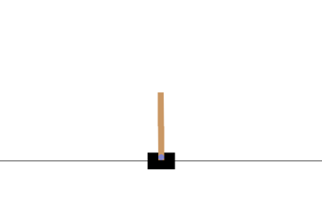
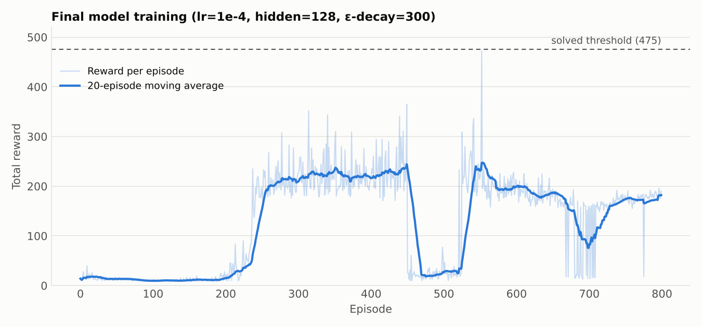
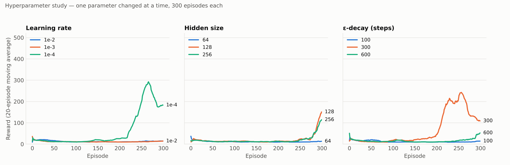

# CartPole-v1 with Double DQN

A Double Deep Q-Network (DDQN) agent that learns to balance the pole in Gymnasium's `CartPole-v1`, implemented from scratch in PyTorch. The project includes a hyperparameter study (learning rate, network width, exploration schedule) and a final trained agent.



## Results

The final model was evaluated greedily (ε = 0) over 100 episodes.

| Model | Mean reward (100 greedy episodes) | Std | Min / Max | Episodes to reach avg ≥ 475 |
|-------|-----------------------------------|-----|-----------|-----------------------------|
| Final DDQN (lr=1e-4, hidden=128, ε-decay=300) | 231.7 | 43.2 | 178 / 408 | Not reached in 800 episodes |

The agent learns a stable balancing policy (from ~10 to ~230 reward) but does not reach the 475 "solved" threshold. Training also shows a temporary collapse around episode 450 before recovering, a known instability of DQN-family methods.



## Method

- **Double DQN target**: the policy network selects the next action and the target network evaluates it, which reduces the overestimation bias of vanilla DQN.
- **Experience replay**: buffer of 10,000 transitions, mini-batches of 64, training starts after 1,000 transitions.
- **Target network**: hard update every 1,000 environment steps.
- **Exploration**: exponentially decaying ε-greedy, from 1.0 to 0.05.
- **Stability**: Huber loss and gradient clipping (max norm 10).
- **Network**: MLP, 4 → hidden → hidden → 2, ReLU activations.
- **Other**: γ = 0.99, Adam optimizer, seed 42.

## Hyperparameter Study

Each configuration was trained for 300 episodes, changing one parameter at a time (defaults: lr=1e-3, hidden=128, ε-decay=600).

Values are the mean reward over the last 50 training episodes.

| Parameter | Values tested | Mean reward (last 50 episodes) | Best | Observation |
|-----------|---------------|--------------------------------|------|-------------|
| Learning rate | 1e-2, 1e-3, 1e-4 | 13.9 / 13.1 / 219.9 | 1e-4 | Only the smallest learning rate learned within 300 episodes |
| Hidden size | 64, 128, 256 | 11.7 / 78.2 / 64.0 | 128 | 64 units did not learn; 128 and 256 started improving late |
| ε-decay (steps) | 100, 300, 600 | 11.6 / 142.6 / 34.6 | 300 | Very fast decay (100) left too little exploration |

**Note on variance.** The runs `lr=1e-3`, `hidden=128` and `ε-decay=600` use identical settings, yet ended at 13.1, 78.2 and 34.6. Differences of this size between single runs come largely from randomness, so these comparisons are indicative only; averaging over several seeds would make them conclusive.



## Project Structure

```
main.py                  Training and hyperparameter experiments
play.py                  Visual demonstration of the trained agent
assets/                  Figures used in this README
results_cartpole_dqn/    Saved models, reward logs (CSV) and plots (created by main.py)
report.pdf               Full project report
requirements.txt
```

## How to Run

```bash
pip install -r requirements.txt
python main.py   # runs the hyperparameter study and trains the final model
python play.py   # watch the trained agent
```

## Possible Extensions

- Comparison with vanilla DQN under the same settings
- Results averaged over multiple seeds, with confidence intervals
- Dueling architecture and prioritized experience replay

## Academic Context

Developed for the course *Computational Intelligence – Deep Reinforcement Learning*, Department of Informatics, Aristotle University of Thessaloniki.

## Author

**Grigoris Liatsos** · [GitHub](https://github.com/grigorisliatsos)
